✨ Need help or want to chat? Join our new [Discord Server](https://discord.gg/qyaY6QXjdh) ✨

# RaptHooker

RaptHooker - A fully local dashboard for Kegland Rapt devices that runs on a Raspberry Pi.

- Track any number of RAPT Pills, RAPT Bluetooth Thermometers and iSpindels, and (experimental) Tilts and RAPT Laser
  Levels
- Unlimited webhooks and integrations at any frequency
- All data is stored on your own hardware and can't be accessed by arbitrary employees
- Only requires a cheap Raspberry Pi with SD card and power, and a PC to install it for the first time
- Anytime-calibration, even when the Pill is in a fermenter
- TV/Kiosk mode for an always-on brewery screen, [image endpoint for simple screens](docs/screens.md),
  [RaptHooker screens](docs/rapthooker-screens.md) (turn a Smart weather clock or an ESP32-2432S028 board into a display for your pills), predictions, backups and exports, etc.

(Click to play quick description video)

<a href="https://www.youtube.com/watch?v=8DBBo27G_4w"></a>

Everything it does, in detail: [docs/features.md](docs/features.md). All the guides are listed in
[docs/README.md](docs/README.md).

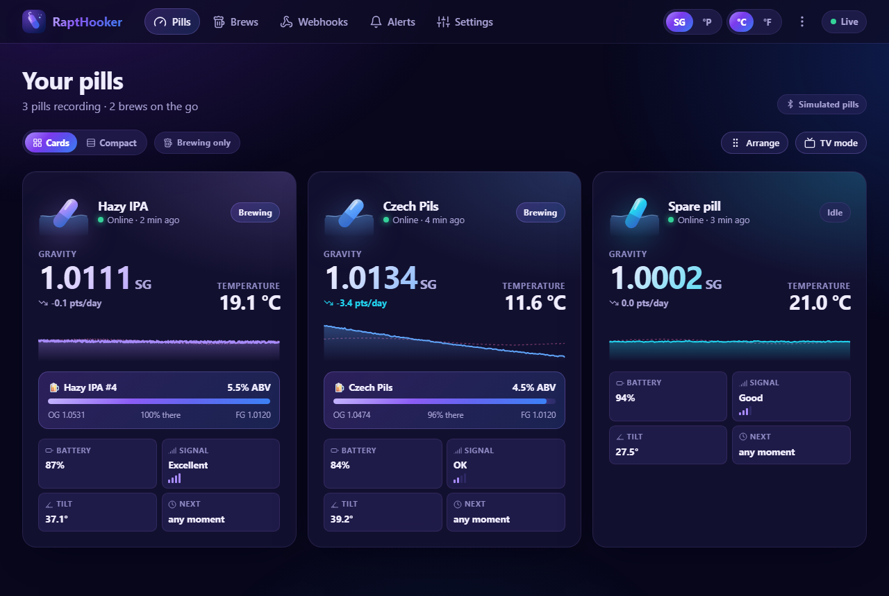

Webhooks: start from a preset for Brewfather, Grainfather, Brewer's Friend, Home Assistant and more, or build your own:

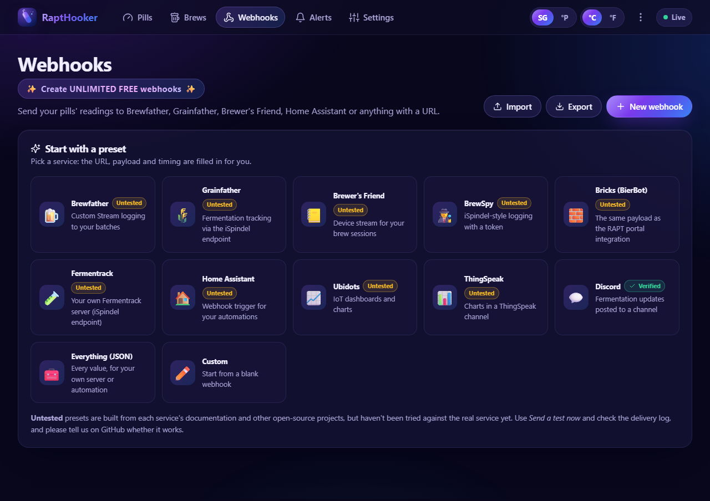

| A pill and its brew                | Webhook editor                                    | On a phone                       |
| ---------------------------------- | ------------------------------------------------- | -------------------------------- |
| 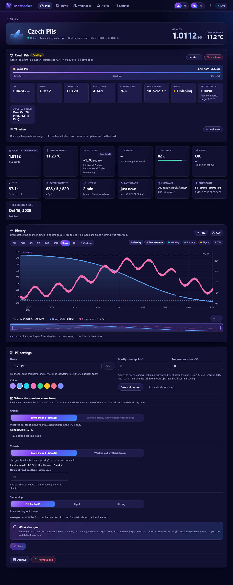 | 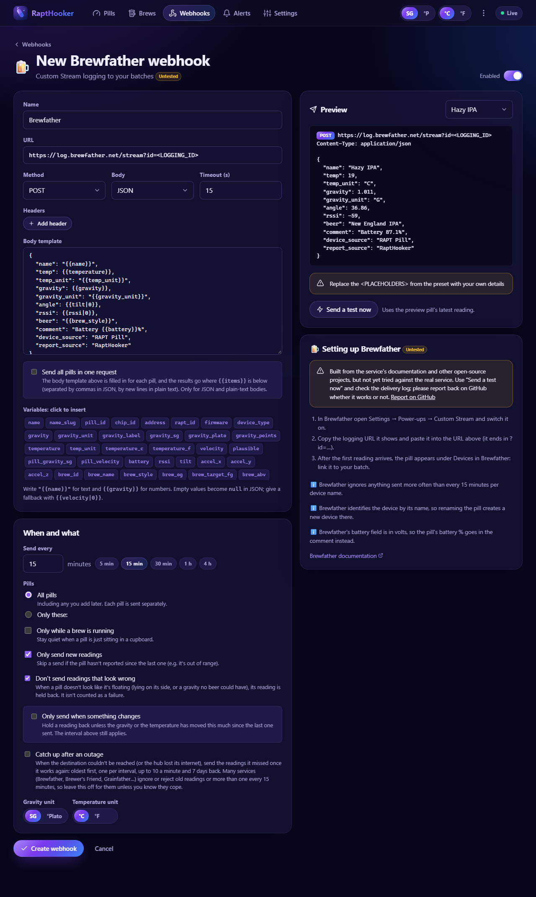 | 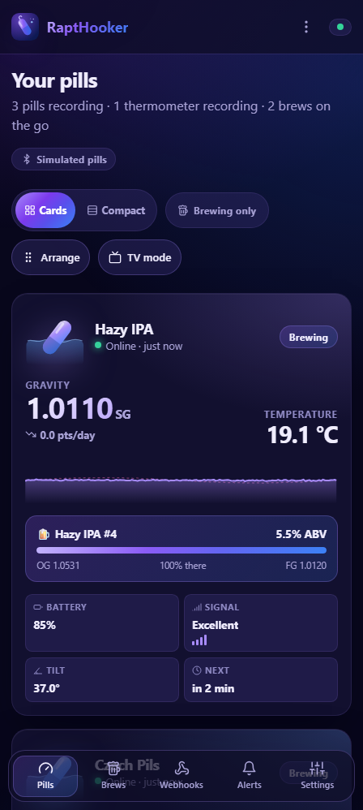 |

Kiosk mode, for an always-on screen in the brewery:

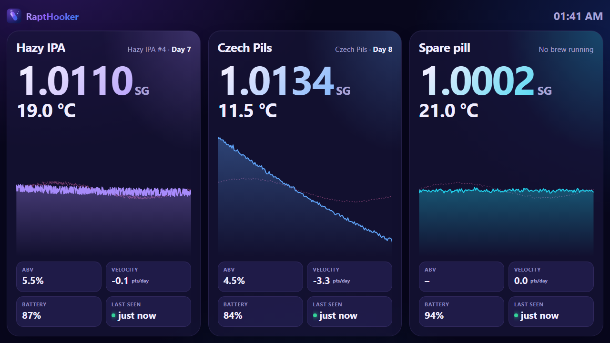

## Currently Supported Devices

- **RAPT Pill** (gravity and temperature), set to [Bluetooth telemetry](#switch-a-rapt-pill-to-bluetooth).
- **RAPT Bluetooth Thermometer** (temperature): no setup needed, just switch it on near the Pi.
- **iSpindel** (gravity and temperature), the DIY Wi-Fi hydrometer: the hub can set it up for you from its setup
  hotspot, or you type the details shown into its own setup page ([guide](docs/ispindel.md)).
- **Tilt** (gravity and temperature, experimental: not tried with a real one yet), any colour, Pro too
  ([guide](docs/tilt.md)).
- **RAPT Laser Level** (how full a keg is, experimental: not tried with a real one yet) ([guide](docs/laser-level.md)).

Press **Add device** on the dashboard to add any of them.

### Screens (experimental)

RaptHooker can put its own firmware on these and use them as displays for your pills
([guide](docs/rapthooker-screens.md)):

- **Smart weather clock** (unbranded, on "SD Pro" firmware), set up over its own Wi-Fi
  ([confirmed working](https://www.aliexpress.com/item/1005011924447121.html))
- **GeekMagic Ultra** (the genuine one the Smart weather clock copies), set up over its own Wi-Fi or from its address
  ([confirmed working](https://www.aliexpress.com/item/1005007542991850.html))
- **ESP32-2432S028 2.8" ("Cheap Yellow Display")**, set up plugged into the Pi's USB
  ([confirmed working](https://www.aliexpress.com/item/1005010399042230.html))

The links only show where users bought one that then worked; they aren't endorsements, and a listing can change what
it sends. Other screens may not work: see [Other screens](docs/rapthooker-screens.md#other-screens). Any screen that
can show a picture from a web address can use an [image link](docs/screens.md) instead.

## Integrations

✅ Verified against the real service. ❔ Untested: built from the service's documentation, so please
[report back](https://github.com/roguecode/RaptHooker/issues) if you try one.

- ✅ **Home Assistant** by webhook: automations, and sensors for your pills ([guide](docs/home-assistant.md#without-mqtt-a-webhook))
- ✅ **Grainfather**
- ✅ **BrewSpy**
- ✅ **Discord**
- ✅ **MeadTools**
- ❔ **Home Assistant** by MQTT: each pill added as a device automatically ([guide](docs/home-assistant.md))
- ❔ **Brewfather**
- ❔ **Brewer's Friend**
- ❔ **Bricks (BierBot)**
- ❔ **Fermentrack**
- ❔ **Ubidots**
- ❔ **ThingSpeak**

Or send readings anywhere with your own [webhook](docs/webhooks.md), MQTT, or the read-only [API](docs/api.md). Setup
notes for each service are in [docs/webhooks.md](docs/webhooks.md#presets).

## Experimental

RaptHooker is a Work-In-Progress - features may not all work and may break at any time. Feel free to submit PR's or
put the details in a [GitHub issue](https://github.com/roguecode/RaptHooker/issues).

## How it works

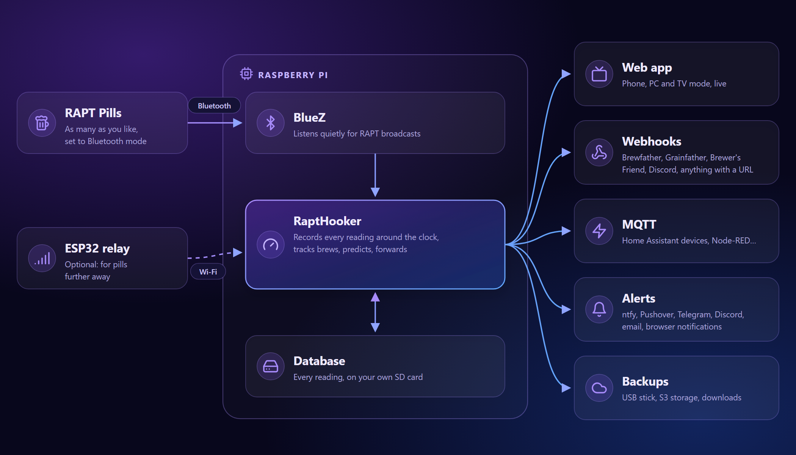

RAPT Pills in Bluetooth mode broadcast their readings; nothing has to pair or connect. RaptHooker, on a Raspberry Pi
near your fermenters, listens for those broadcasts, decodes them (the format is documented by KegLand, see
[attribution.md](attribution.md)) and records every reading in a database on the Pi's SD card. From there it shows them
in the web app and sends them wherever you've asked: webhooks, MQTT (Home Assistant), alerts and backups. An optional
ESP32 relay can pass on broadcasts from pills that are too far from the Pi.

## Install

(Click to play quickstart install video)

<a href="https://www.youtube.com/watch?v=ly00YsKGYaY">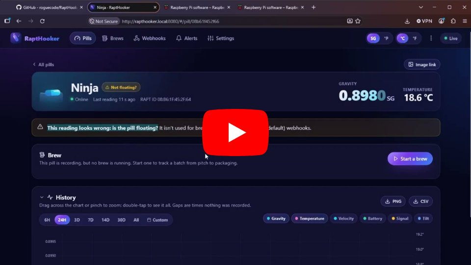</a>

You need a **Raspberry Pi 3, 4, 5 or Zero 2 W** (not the original Pi Zero W) with its power supply, a **microSD card**
of 8 GB or more, and a computer to write the card. It takes about 20 minutes, most of it waiting.

1. Write **Raspberry Pi OS Lite (64-bit)** to the card with
   [Raspberry Pi Imager](https://www.raspberrypi.com/software/). In its settings, set the hostname to `rapthooker`,
   pick a username and password, add your Wi-Fi and switch SSH on.
2. Start the Pi, connect to it with `ssh pi@rapthooker.local` (with your username) and run:

   ```bash
   curl -fsSL https://raw.githubusercontent.com/roguecode/RaptHooker/main/deploy/install.sh | sudo bash
   ```

3. Open **http://rapthooker.local:8080**, create an owner PIN and add your pill (once it's
   [set to Bluetooth](#switch-a-rapt-pill-to-bluetooth)).

Every step in detail, with the settings to pick in Imager and what to do if something doesn't work:
[docs/pi-setup.md](docs/pi-setup.md). It also covers HTTPS and access away from home with Tailscale, installing a
particular version, installing on a machine without Bluetooth (an LXC container, say), and the ready-made Pi image.

## Switch a RAPT Pill to Bluetooth

If your RAPT Pills are currently set to WiFi then you need to switch them to Bluetooth. This can be done with both the old (v1) and new (v2) stock firmware.

### Original firmware (V1)

1. Plug the pill into USB-C power, or put it on its wireless charger. Its setup network is only there while it's
   charging.
2. On your phone, open the Wi-Fi settings and join the **RAPT Pill XXXX** network. The password is `kegland1`.
3. Your phone offers to **sign in** to the network: select it to open the pill's setup page. If it doesn't, select the
   **RAPT Pill** network in the Wi-Fi settings again.
4. Under **Other stuff**, select **Settings**.
5. Set **Telemetry method** to **Bluetooth**.
6. If you like, change **Telemetry interval (Bluetooth)** and select **Set interval (Bluetooth)**. It's the minutes
   between broadcasts: shorter means fresher readings but a flatter battery (KegLand recommends 5).

[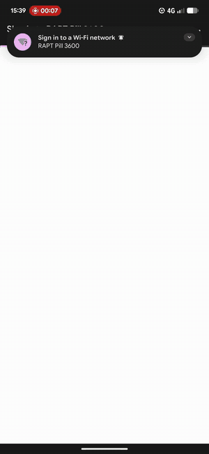](docs/videos/pill-to-bluetooth-v1.mp4)

### New firmware (V2)

1. In the RAPT app, open the pill and select **Connect to Pill**, with your phone close to the pill.
2. When your phone asks to pair with the **RAPT Pill Hydrometer**, select **Pair**.
3. Once it's connected, select **Setup**. It shows **Direct Change via BLE**: changes go straight to the pill.
4. Set **Telemetry via** to **Bluetooth**. If you like, change the **BLE Telemetry Frequency**, how often it
   broadcasts.
5. Select **Apply**. The app confirms with **Settings applied to the Pill via Bluetooth**.

[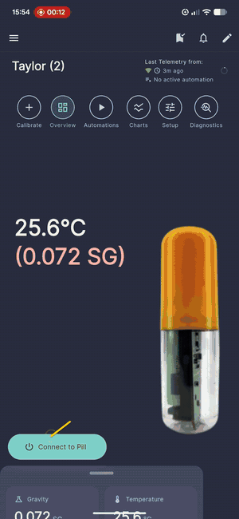](docs/videos/pill-to-bluetooth-v2.mp4)

### Once it's switched

After its next broadcast, the pill appears on RaptHooker's dashboard under **Found a RAPT Pill nearby**. Name it if you
like and select **Add pill**: from then on every reading is recorded.

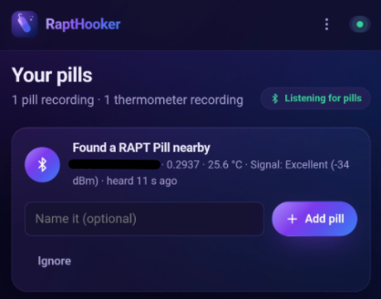

## Updating

RaptHooker checks for a new version once a day and shows a banner when there is one. Select **Update now** and it
updates itself, going back to the version you had if the new one doesn't start. You can also run the install line
again at any time: your data and settings stay. To try what's coming, pick a beta under Settings → Updates → **Beta
versions**, and go back to the release from there whenever you like. See [docs/updating.md](docs/updating.md).

## Configuration

Almost everything is set up in the app. A few settings the hub needs before it starts (its port, which Bluetooth
adapters to use, how long to keep raw readings and so on) live in a small file on the Pi. See
[docs/configuration.md](docs/configuration.md).

## Develop

RaptHooker is written in TypeScript: a Node.js server and a React web app, with simulated pills so you can work on it
without a Pi or a pill. See [docs/development.md](docs/development.md) for running it on your computer, the tests, and
building and deploying your own version.

## Licence and Disclaimer

[GPL-3.0](LICENSE). RaptHooker isn't affiliated with KegLand, RAPT or any of the services it can send data to.
Credits for the libraries, icons and references it builds on are in [attribution.md](attribution.md).

To the maximum extent permitted by applicable law, you agree to indemnify, defend, and hold harmless the author(s) and maintainers from and against any third-party claims, liabilities, damages, losses, or expenses (including legal fees) arising out of or in connection with your deployment, modification, or use of this software.

## Alternatives and related projects

Here is an incomplete list of related open-source projects:
[docs/alternatives.md](docs/alternatives.md).
