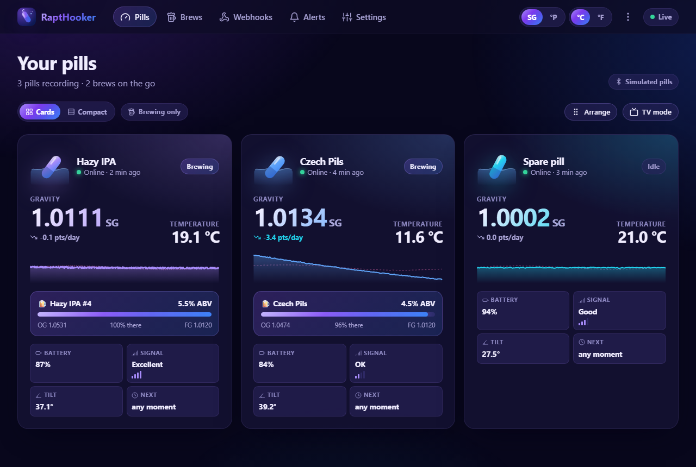
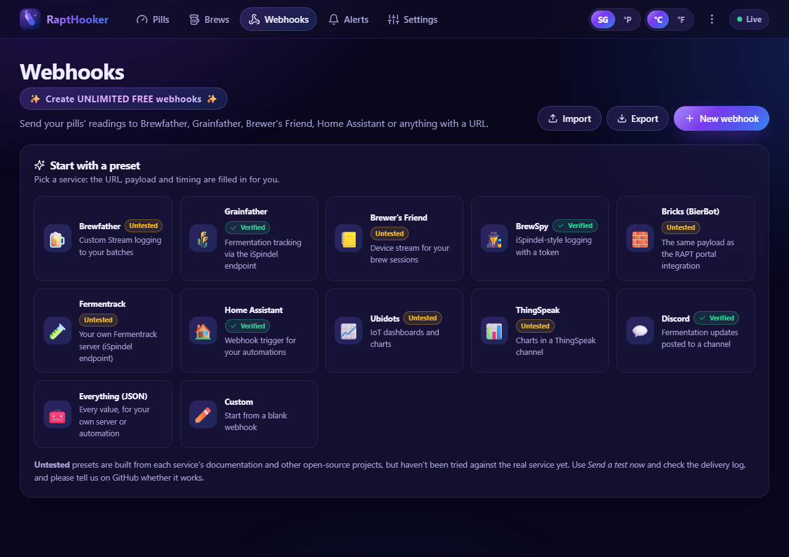
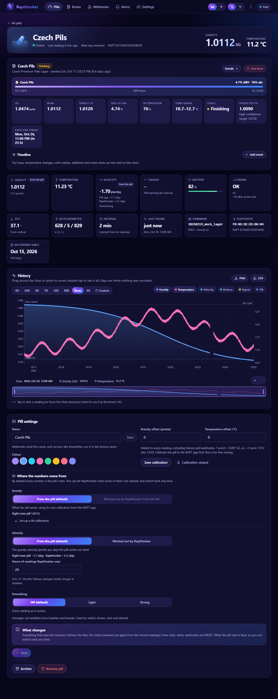
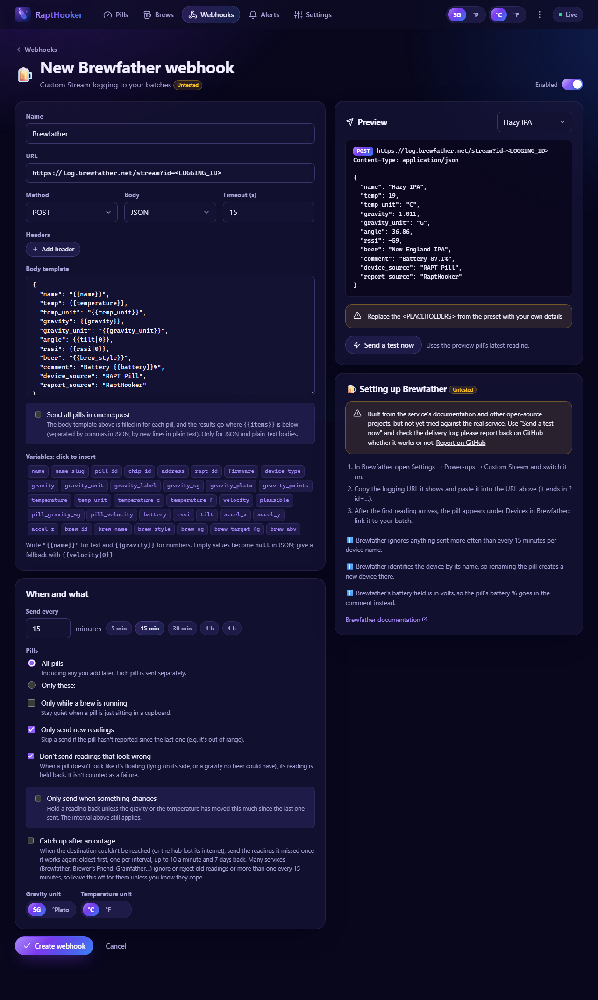
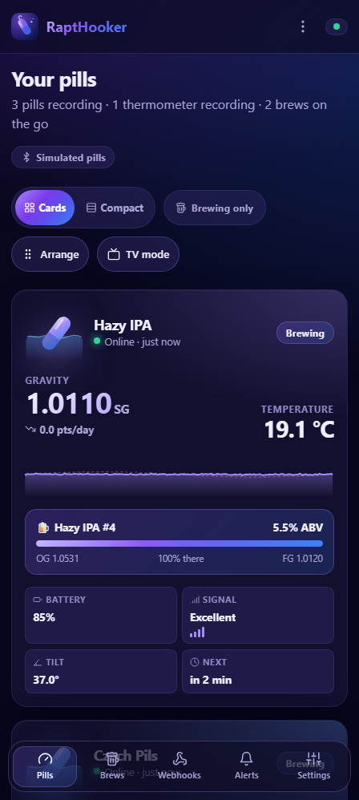
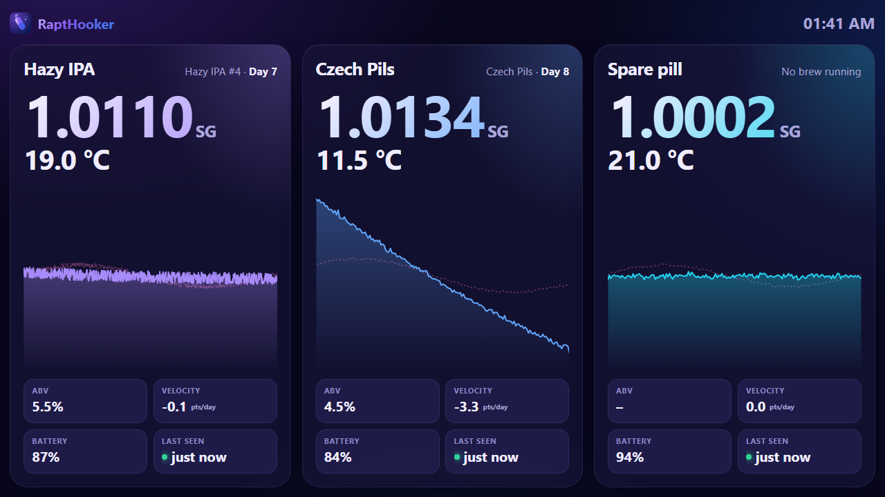
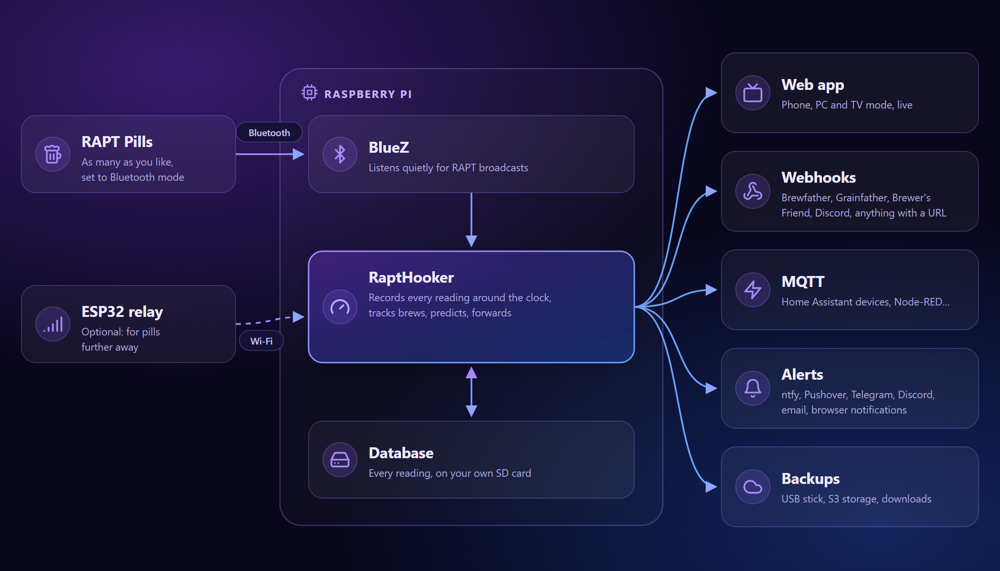

# RaptHooker

In a smart move that isn't
[controversial or anti-consumer](https://www.reddit.com/r/Homebrewing/comments/1xc1nl6/kegland_forcing_rapt_users_into_subscription/),
Kegland has added subscriptions to their highly rated Rapt software (1.6⭐ on PlayStore!), removing features that
"[cheap arse customers and freeloaders](docs/receipts.md)" were using.

RaptHooker - A fully local dashboard for Kegland Rapt devices that runs on a Raspberry Pi.

- Track any number of RAPT Pills, and RAPT Bluetooth Thermometers
- Unlimited webhooks and integrations at any frequency
- All data is stored on your own hardware and can't be accessed by arbitrary employees
- Only requires a cheap Raspberry Pi with SD card and power, and a PC to install it for the first time
- Much better overall experience, "Kiosk" mode for an always-on screen, predictions, backups and exports, etc.

Everything it does, in detail: [docs/features.md](docs/features.md).



Webhooks: start from a preset for Brewfather, Grainfather, Brewer's Friend, Home Assistant and more, or build your own:



| A pill and its brew                | Webhook editor                                    | On a phone                       |
| ---------------------------------- | ------------------------------------------------- | -------------------------------- |
|  |  |  |

Kiosk mode, for an always-on screen in the brewery:



(Screenshots use simulated devices.)

## Currently Supported Devices

- **RAPT Pill** (gravity and temperature), set to Bluetooth telemetry.
- **RAPT Bluetooth Thermometer** (temperature): no setup needed, just switch it on near the Pi.

## Integrations

✅ Verified against the real service. ❔ Untested: built from the service's documentation, so please
[report back](https://github.com/roguecode/RaptHooker/issues) if you try one.

- ✅ **Home Assistant** by webhook: automations, and sensors for your pills ([guide](docs/home-assistant.md#without-mqtt-a-webhook))
- ✅ **Grainfather**
- ✅ **BrewSpy**
- ✅ **Discord**
- ❔ **Home Assistant** by MQTT: each pill added as a device automatically ([guide](docs/home-assistant.md))
- ❔ **Brewfather**
- ❔ **Brewer's Friend**
- ❔ **Bricks (BierBot)**
- ❔ **Fermentrack**
- ❔ **Ubidots**
- ❔ **ThingSpeak**

Or send readings anywhere with your own [webhook](docs/webhooks.md), MQTT, or the read-only [API](docs/api.md). Setup
notes for each service are in [docs/webhooks.md](docs/webhooks.md#presets).

## Experimental

RaptHooker is a Work-In-Progress, and cuckcoded based on my previous projects. Kegland are an inspiration to us, so
just like their software, RaptHooker's features may not all work and may break at any time. Feel free to submit PR's or
put the details in a [GitHub issue](https://github.com/roguecode/RaptHooker/issues).

## How it works



RAPT Pills in Bluetooth mode broadcast their readings; nothing has to pair or connect. RaptHooker, on a Raspberry Pi
near your fermenters, listens for those broadcasts, decodes them (the format is documented by KegLand, see
[attribution.md](attribution.md)) and records every reading in a database on the Pi's SD card. From there it shows them
in the web app and sends them wherever you've asked: webhooks, MQTT (Home Assistant), alerts and backups. An optional
ESP32 relay can pass on broadcasts from pills that are too far from the Pi.

## Install

It takes about 20 minutes, most of it waiting. No experience needed: just follow the steps.

### What you need

- A **Raspberry Pi 3, 4, 5 or Zero 2 W** with its power supply. (The original Pi Zero W is currently not supported.)
- A **microSD card**, 8 GB or bigger.
- A **computer** (Windows, Mac or Linux) that can write to the card. Most laptops have a slot; otherwise use a cheap
  USB card reader.
- Your **Wi-Fi name and password**, or a network cable for the Pi.
- Your **RAPT Pill set to Bluetooth**: in the RAPT app open the pill, then **Connect → Setup → Telemetry via
  Bluetooth**. The pill then broadcasts its readings for RaptHooker to pick up (instead of sending them to KegLand's
  cloud). The telemetry interval you choose there is how often it broadcasts. The new beta firmware is currently untested, stick with the original for now.

### 1. Prepare the SD card

1. On your computer, download and install the official **Raspberry Pi Imager** from
   [raspberrypi.com/software](https://www.raspberrypi.com/software/), and put the microSD card in.
2. Open Imager and choose:
   - **Device:** your Raspberry Pi model.
   - **Operating system:** **Raspberry Pi OS (other)**, then **Raspberry Pi OS Lite (64-bit)**.
   - **Storage:** your microSD card. Double-check it's the card: everything on it is wiped.
3. Imager then asks for some settings (on older versions, select **Edit settings** when it asks about OS
   customisation). Fill in:
   - **Hostname:** `rapthooker`
   - **Username and password:** choose your own, e.g. username `pi`, and write them down.
   - **Wi-Fi:** your network's name and password, and your country. Skip this if the Pi will use a network cable.
   - **Time zone and keyboard:** yours.
   - **SSH** (called **Remote access** in newer versions): turn it **on**, with password login.
4. Write the card. It takes a few minutes, and Imager tells you when it's done.

### 2. Start the Pi

Put the card in the Pi, plug in the network cable if you're using one, then plug in the power. The first start takes
about 3 minutes.

### 3. Install RaptHooker

1. On your computer, open a terminal:
   - **Windows:** right-click the Start button and choose **Terminal** (or **Windows PowerShell**).
   - **Mac:** open **Terminal** (in Applications → Utilities).
   - **Linux:** open your terminal app.
2. Connect to the Pi by typing this and pressing Enter (use the username you chose instead of `pi`):

   ```bash
   ssh pi@rapthooker.local
   ```

   The first time, it asks whether you trust the Pi: type `yes` and press Enter. Then type your password and press
   Enter. Nothing shows on the screen while you type the password; that's normal.

3. Copy this line, paste it into the terminal (right-click pastes in the Windows terminal, Cmd+V on a Mac) and press
   Enter:

   ```bash
   curl -fsSL https://raw.githubusercontent.com/roguecode/RaptHooker/main/deploy/install.sh | sudo bash
   ```

   It may ask for your password again. Installing takes 5 to 15 minutes. When it's finished, it prints the address to
   open.

### 4. Open RaptHooker

On any phone or computer on the same network, open **http://rapthooker.local:8080**. A short guide on the dashboard
walks you through the rest:

1. **Create an owner PIN**, so only you can change things. Anyone on your network can look.
2. **Add your pill.** It appears under **Found a RAPT Pill nearby** the next time it broadcasts. Select **Add pill**.
3. That's it: from now on every reading is recorded, day and night. Start a brew, add webhooks (Brewfather and the
   others are in the list) and set up alerts whenever you like.

On a phone, use your browser's **Add to Home Screen** to open it like an app.

### If something doesn't work

- **`rapthooker.local` can't be found:** some networks (and some Windows computers) don't handle `.local` names well.
  Find the Pi's IP address in your router's list of connected devices (look for "rapthooker"), and use that instead,
  e.g. `ssh pi@192.168.1.23` and `http://192.168.1.23:8080`.
- **`ssh` says the connection was refused or timed out:** give the Pi another minute. If it still doesn't work, SSH
  probably wasn't switched on: write the card again (step 1) and check the SSH setting.
- **No pill appears:** check the pill is in Bluetooth mode and close to the Pi. A fridge or a stainless steel fermenter
  makes it harder to hear. More help: [troubleshooting](docs/pi-setup.md#troubleshooting).
- More options (HTTPS and access away from home with Tailscale, a particular version, a ready-made Pi image) are in
  [docs/pi-setup.md](docs/pi-setup.md).

## Updating

RaptHooker checks for a new version once a day and shows a banner when there is one. Select **Update now** and it
updates itself, going back to the version you had if the new one doesn't start. You can also run the install line
again at any time: your data and settings stay. See [docs/updating.md](docs/updating.md).

## Configuration

Almost everything is set up in the app. A few settings the hub needs before it starts (its port, which Bluetooth
adapters to use, how long to keep raw readings and so on) live in a small file on the Pi. See
[docs/configuration.md](docs/configuration.md).

## Develop

RaptHooker is written in TypeScript: a Node.js server and a React web app, with simulated pills so you can work on it
without a Pi or a pill. See [docs/development.md](docs/development.md) for running it on your computer, the tests, and
building and deploying your own version.

## Licence and Disclaimer

[GPL-3.0](LICENSE). RaptHooker isn't affiliated with KegLand, RAPT or any of the services it can send data to.
Credits for the libraries, icons and references it builds on are in [attribution.md](attribution.md).

To the maximum extent permitted by applicable law, you agree to indemnify, defend, and hold harmless the author(s) and maintainers from and against any third-party claims, liabilities, damages, losses, or expenses (including legal fees) arising out of or in connection with your deployment, modification, or use of this software.

## Alternatives and related projects

While we have no idea why someone would want to avoid being locked into the Kegland subscriptions after purchasing
full-priced hardware, here is an incomplete list of related open-source projects:
[docs/alternatives.md](docs/alternatives.md).
