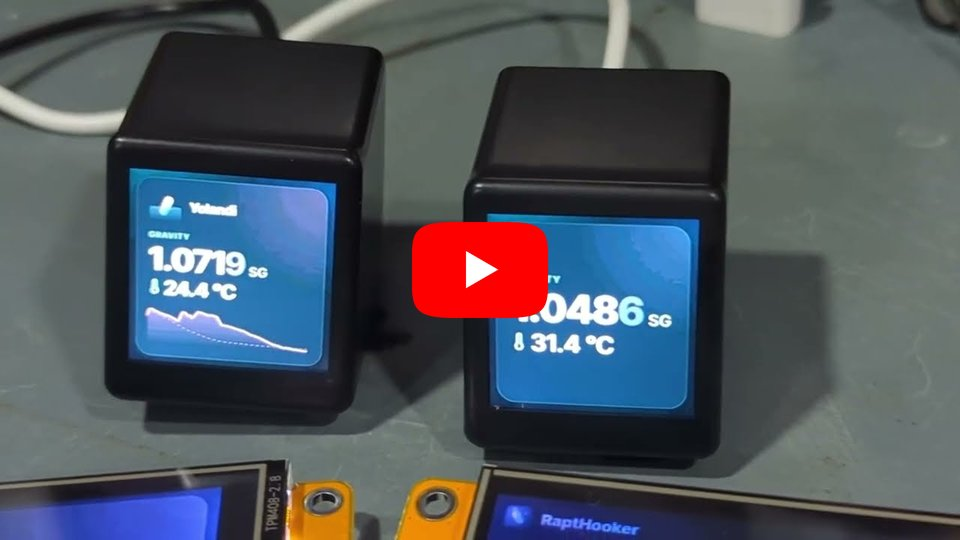

# RaptHooker screens

RaptHooker can turn a small screen into a display for your pills. The hub puts its own firmware on the screen and
connects it to your Wi-Fi. From then on the screen fetches a picture from the hub every minute (or as often as you
like), drawn like an [image link](./screens.md): one pill or all of them, in the look you choose. The hub keeps the
screen's firmware up to date and shows how each screen is doing under **Screens**.

The picture fills the whole screen while all is well. When something's wrong (it can't reach the hub, it's
reconnecting to Wi-Fi, it hasn't had a new picture for a while) the screen says so in a line under the picture.

> **Experimental.** Screens are new. They've been tested with the screens below only, and how they're set up and
> looked after may still change. The **Screens** page says so too, and lists the same screens.

## Supported screens

| Screen                                           | Picture   | How the hub sets it up                         | Confirmed working                                                           |
| ------------------------------------------------ | --------- | ---------------------------------------------- | --------------------------------------------------------------------------- |
| **Geekmagic Ultra/Smart weather clock**          | 240 × 240 | Over its own Wi-Fi, from its original firmware | [AliExpress listing](https://www.aliexpress.com/item/1005011924447121.html) |
| **ESP32-2432S028 2.8" ("Cheap Yellow Display")** | 320 × 240 | Plugged into the hub's USB                     | [AliExpress listing](https://www.aliexpress.com/item/1005010399042230.html) |

The listings only show where users bought a screen that then worked with RaptHooker. **They aren't endorsements**:
RaptHooker has nothing to do with the sellers, and a listing can change what it sends, so check the model in its
pictures before you buy.

### Other screens

- **Might work (untested):** ESP32-2432S028 boards with two USB sockets (USB-C and micro USB). They usually have another
  display chip, which RaptHooker tries; check it with [Does the screen look right?](#does-the-screen-look-right) after
  setting one up.
- **Won't work:** other GeekMagic screens, and weather clocks on other firmware. The hub checks a screen before it
  changes anything, so trying one does no harm.
- **Won't work:** other ESP32 boards and sizes (2.4", 3.5", ESP32-S3 boards). Their displays are wired differently and
  would stay blank. Don't set one up as an ESP32-2432S028: that replaces what's on the board.
- **Any screen** that can show a picture from a web address can use an [image link](./screens.md) instead, with no new
  firmware.

## What you need

- One of the screens above:
  - a **Geekmagic Ultra/Smart weather clock** on its original "SD Pro" firmware. When it's new it opens a Wi-Fi network
    called **Smart weather clock** (or **Smart weather clock Pro**) and shows set-up instructions with a QR code.
  - an **ESP32-2432S028** board (sold as the "Cheap Yellow Display", with a 2.8" 320 × 240 touch screen), and a USB
    cable that carries data, not just power. Whatever it came with is replaced.
- A **2.4 GHz** Wi-Fi network for the screen, on which it can reach the hub. The screens don't do 5 GHz.
- For a Geekmagic: a hub that can leave its Wi-Fi for a minute to talk to the screen. A Raspberry Pi set up with the
  installer can (see [Permissions](#permissions)). Otherwise, a phone or laptop with Wi-Fi does the setting up instead
  (see [From a browser](#from-a-browser)).
- For an ESP32 board: a hub with esptool, which the Pi installer adds (see [Permissions](#permissions)). The hub never
  leaves its own network for these.

## Adding a screen

**Add a screen** has two tabs: **Wi-Fi screen** for a Geekmagic, and **Plugged into the hub (USB)** for an ESP32 board.
It opens on the USB tab when a board is plugged in.

### A Geekmagic, over Wi-Fi

1. Plug the screen in, near the hub.
2. In the app, open **Screens**, press **Add a screen** and pick **Wi-Fi screen**. The hub looks for Wi-Fi networks and
   picks out the screens' own; the rest are tucked away under **other networks** in case yours has another name.
3. Press **Set up** next to the screen. Give it a name, choose what it shows, and the Wi-Fi network it should join. The
   hub's own network is filled in, and on a Pi the hub knows its password, so you can leave that empty.
4. Press **Set it up**. The hub then:
   - joins the screen's Wi-Fi and checks it really is a Geekmagic Ultra/Smart weather clock on its original firmware,
   - installs RaptHooker's firmware through the screen's own update page and waits for it to restart,
   - has the screen try your Wi-Fi while the hub is still with it (so a wrong password is reported, not guessed at),
   - goes back to its own network, finds the screen there and saves it.

It takes about half a minute to a minute. The page shows each step as it happens, and when it's done, the screen's IP
address, name on the network, MAC address and firmware. If the hub's only connection is Wi-Fi it's off your network
while it talks to the screen: the page says so and reconnects by itself.

**Keep the screen plugged in while it's being set up.** Installing firmware is the one moment a screen can be harmed:
for a few seconds after the firmware arrives the screen copies it into place, and losing power then could leave it
unable to start. RaptHooker only ever sends firmware it has checked is complete and right for this screen, and small
enough for the screen's update page (which cuts bigger files short), and only to a screen it has identified.

### From a browser

When the hub can't switch Wi-Fi networks (it runs in Docker, its system doesn't use NetworkManager, or it isn't
allowed to), **Add a screen** offers to do it from your phone or laptop instead. **Set it up from this device instead**
does the same when the screen is out of the hub's reach.

1. Fill in the screen's name, what it shows, and your Wi-Fi's name and password, and press **Next**. The page fetches
   the firmware from the hub while you're still on your network.
2. Join the screen's Wi-Fi (**Smart weather clock**) on the phone or laptop, come back to the page and press
   **I've joined it**. The page checks the screen and installs the firmware.
3. When the screen restarts, join its new network, **RaptHooker-Screen-** and six characters. The page gives the
   screen your Wi-Fi details and waits for it to join.
4. Go back to your own Wi-Fi. The page tells the hub about the screen.

Keep the page open (don't reload it) until it's done. It needs the hub's `http://` address: a page opened over
`https://` (through Tailscale, say) isn't allowed to talk to the screen, and says so. If your phone warns that the
screen's network has no internet, choose to stay connected.

### An ESP32 board, over USB

1. Plug the board into one of the hub's USB ports.
2. In the app, open **Screens** and press **Add a screen**. The **Plugged into the hub (USB)** tab lists the hub's
   serial ports, with ones that look like a board (their USB chip is one ESP32 boards use) picked out. Press **Look
   again** after plugging one in.
3. Press **Set up** next to the board. Check the board's model, give it a name, choose what it shows, and the Wi-Fi
   network it should join (with its password, unless it's the hub's own network on a Pi).
4. Press **Set it up**. The hub then:
   - asks the board what it is, and checks it's the chip the firmware is for, with enough flash,
   - writes RaptHooker's firmware and its settings (your Wi-Fi, its key, where to fetch pictures) in one go,
   - restarts it and reads what it prints as it starts: whether it joined your Wi-Fi, and if not, why (a wrong
     password, a network it can't see),
   - finds it on your network and saves it.

It takes about a minute, most of it writing the firmware (the page shows how far it has got). Setting a board up
again (with another Wi-Fi network, say) rewrites everything, and keeps its key and display corrections.

Once it's set up the board needs only power: unplug it from the hub and put it wherever you like, on any USB charger,
within reach of your Wi-Fi. If you leave it powered from the hub, the USB tab knows it: the hub asks each board which
screen it is (without restarting it), lists your screens under **Already set up** (with **Set up again**), and only
opens on the USB tab by itself when a board isn't one of your screens yet. Boards on firmware older than 1.1.1 don't
answer, so they're listed as new until they're updated.

### Does the screen look right?

Boards sold under one name come with different display panels, some mounted the other way round. RaptHooker recognises
the panels it knows, and when an ESP32 board is set up, asks **Does the screen look right?** **Show the test pattern**
puts up red, green and blue bars with their names, and words. It's right when red is at the top, the words read left to
right and the band at the bottom is black. If it isn't, **Turn it upside down**, **Mirror it**, **Swap red and blue** or
**Invert the colours**: each shows straight away and the screen keeps it. The same buttons are in the screen's
settings.

## What it shows

Press **Edit** on a screen (or its picture) to choose:

- which pill it shows, or all of them (optionally only those with a brew running),
- what's on the picture and how it looks: the same choices as an [image link](./screens.md), with a preview,
- how often it fetches a new picture, and how bright it is.

Changes show on the screen straight away. A screen is tied to its pill everywhere in the app: the pill's page shows a
chip for each screen showing it (press it to change the screen), and the pill's card on the dashboard has a little
screen mark. Screens showing every pill have chips next to **Image link** on the dashboard.

You can also design a picture in the **Image link** dialog and send it to a screen with **Show this on a screen**. The
screen keeps its own size.

## On the screen

| The screen shows                                            | Meaning                                                                                                                |
| ----------------------------------------------------------- | ---------------------------------------------------------------------------------------------------------------------- |
| The picture, filling the screen                             | All is well                                                                                                            |
| The picture with a line under it                            | Something needs attention: it hasn't had a new picture for a while, it's reconnecting to Wi-Fi, the hub didn't answer… |
| The RaptHooker logo, its network, IP address, MAC, firmware | Set up but no picture yet, or nothing to show                                                                          |
| Set-up instructions and its network's name                  | Waiting to be set up                                                                                                   |
| A six-digit code                                            | A hub asked to add it: type the code into the app                                                                      |
| Its name, big                                               | **Show its name** was pressed                                                                                          |
| Red, green and blue bars with their names                   | The test pattern, for **Does the screen look right?**                                                                  |

To see a screen's own details over its picture for half a minute, press the button on a Geekmagic's back, or tap an
ESP32 board's screen (or press its **BOOT** button).

A screen that has been away from its Wi-Fi for 5 minutes opens its own network again (**RaptHooker-Screen-…**) while it
keeps trying, so it can be given new Wi-Fi details: it shows up under **Add a screen**. A screen that keeps crashing
starts in a safe mode with just Wi-Fi and updates, so it can always be updated.

## Firmware updates

Each version of RaptHooker comes with the screens' firmware. When it has newer firmware than a screen, the **Screens**
tab gets a dot and the page offers **Update** (or **Update all**). Each screen checks the new firmware before
installing it, restarts once (about half a minute) and keeps its settings. The hub checks it came back with the new
version.

An ESP32 board is safer still: it keeps the firmware it had alongside the new one, and the new one only stays once it
has joined your Wi-Fi and drawn a picture. If it crashes, or hasn't managed that within 10 minutes, the board goes back
to the firmware it had by itself (and the hub says the update didn't finish).

Newer firmware only ever adds to what the screens understand, so an older hub keeps working with a screen that has
been updated by a newer one, and the other way round.

## Found on your network

Screens announce themselves on the network, so the hub can always find them again. If you reinstall RaptHooker, lose
its data, or move a screen to another hub, it shows under **Found on your network** (press **Find on network** to look
now). Press **Add**: the screen shows a six-digit code, and typing it in proves you're next to it. After five wrong
codes, or two minutes, ask again; after ten wrong codes the screen takes no more for 15 minutes.

## Looking after a screen

**Screen details**, at the bottom of a screen's settings, has its status, model, firmware, IP address, name on the
network, MAC address, Wi-Fi signal and how long it has been running, and:

- **Show its name**, to tell which screen is which,
- **New picture now**, **Restart** and **Log** (what the screen has been doing, for troubleshooting),
- **Update to …**, when there's newer firmware,
- **Forget**: the hub stops looking after it. Tick **Also reset the screen** to have it forget its Wi-Fi and open its
  own network for setting up again.
- **Put the original firmware back** (a Geekmagic): sends the screen's original firmware back to it, from the
  firmware file its maker provides (`SDPro_V1.0.6.bin`, say). The hub checks the file is firmware for this screen first.
  The screen restarts on its own firmware with its own settings as they were, RaptHooker's are wiped, and the hub
  forgets it. ESP32 boards don't have this: the demo they came with isn't kept. To keep it, copy the board's flash
  before setting it up (`python -m esptool --port COM7 read_flash 0 0x400000 backup.bin`) and write it back the same
  way (`write_flash 0 backup.bin`).
- **Does the screen look right?** (an ESP32 board): the test pattern and the display corrections.

## Permissions

To set a screen up the hub asks NetworkManager to join the screen's network for a minute and then go back. On a
Raspberry Pi the installer (`deploy/pi/setup.d/50-screens.sh`) adds a polkit rule that lets the `rapthooker` user do
just that: change networks, scan for them, add the temporary connection, and read the saved password of the hub's own
network to give to the screen. Older systems without NetworkManager set screens up from a browser.

For ESP32 boards the installer puts [esptool](https://github.com/espressif/esptool) (and pyserial, which it uses to
read what a board prints) in a Python environment of its own, `/usr/local/lib/rapthooker/esptool`, as Debian's esptool
package leaves out a part the ESP32 needs. It also adds the `rapthooker` user to the `dialout` group, which owns the
serial ports boards turn up on. On another system, install esptool with `pip install esptool`; the hub finds a Python
that has it (`python3`, `python`), or set `screens.python` in the [config](./configuration.md).

In [Docker](./docker.md) the hub sets screens up from a browser, and needs to be told the address screens should
fetch pictures from: set `screens.hubUrl` in the [config](./configuration.md) to the host's address, e.g.
`http://192.168.1.20:8080`. USB set-up is off there (`screens.usb`): set an ESP32 board up from a Pi, or from
RaptHooker running on a computer, then add it to the Docker hub from **Found on your network**.

## Troubleshooting

- **The screen isn't in the list.** It only uses 2.4 GHz, and a new screen's network can take a minute to appear after
  it's plugged in. A screen set up before only opens its own network after 5 minutes away from its Wi-Fi. Press
  **Scan again**.
- **Wrong password, network not found.** Check the name (it's case-sensitive) and that the network has a 2.4 GHz band.
- **No IP address.** The screen joined but the router gave it no address. It tries the older 802.11g mode first (some
  mesh routers don't hand out addresses to ESP8266s on 802.11n) and switches modes by itself if it gets no address.
- **The screen shows as offline.** It hasn't fetched a picture for a while: check it has power, then look at its
  screen. **Find on network** follows a screen that has a new address.
- **It says it belongs to another hub.** Add it from **Found on your network** with the code it shows, or reset it from
  the hub that has it.
- **No boards on the USB tab.** Some USB cables only carry power: try another. The board's USB chip (a CH340 or
  CP2102) may need a driver on Windows or macOS; a Pi has them.
- **The hub couldn't talk to the board.** Unplug it and plug it back in. If it still won't, hold the board's **BOOT**
  button while the hub starts writing to it. Close anything else using the port (a serial monitor).
- **The picture is upside down, mirrored or the wrong colours** on an ESP32 board: see
  [Does the screen look right?](#does-the-screen-look-right)

## Privacy and security

Everything stays on your network: a screen talks only to the hub. At set-up the hub gives each screen a key; after
that, only a hub with the key can change the screen's settings or firmware, and a screen won't take firmware that isn't
RaptHooker's (except its own original, put back on purpose). The hub only sends a screen's key to an address that has
first proved it has it, so something else on the network can't pretend to be a screen to get it. The list of screens
is read-only and open like the rest of the [read-only API](./api.md), without the keys.

For developers: the firmware, its HTTP API and how to build it are in
[firmware/screen/README.md](../firmware/screen/README.md).
