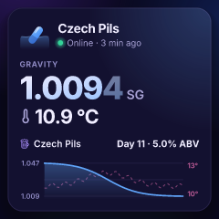
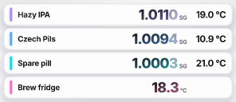
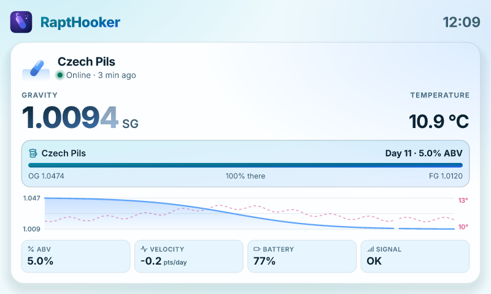
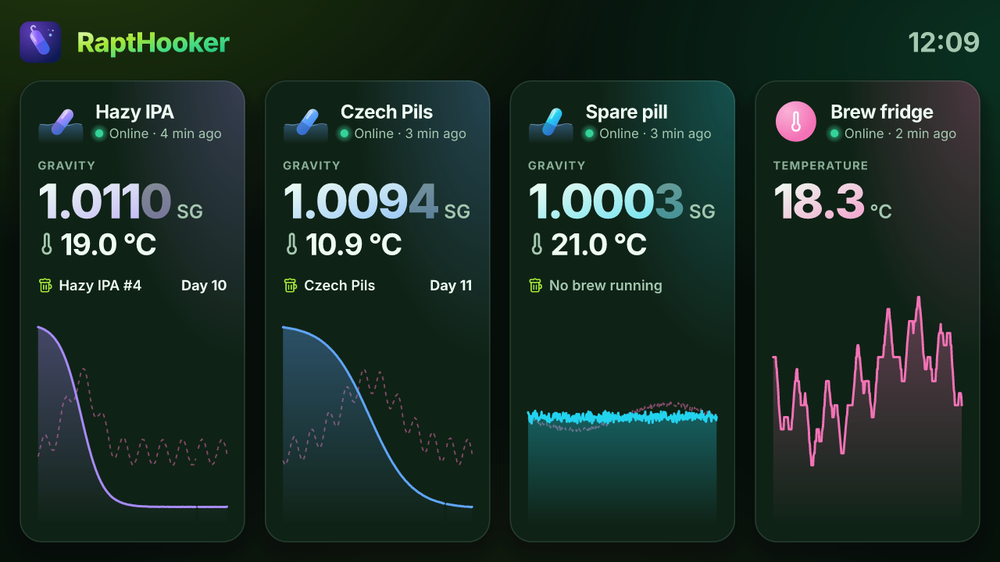
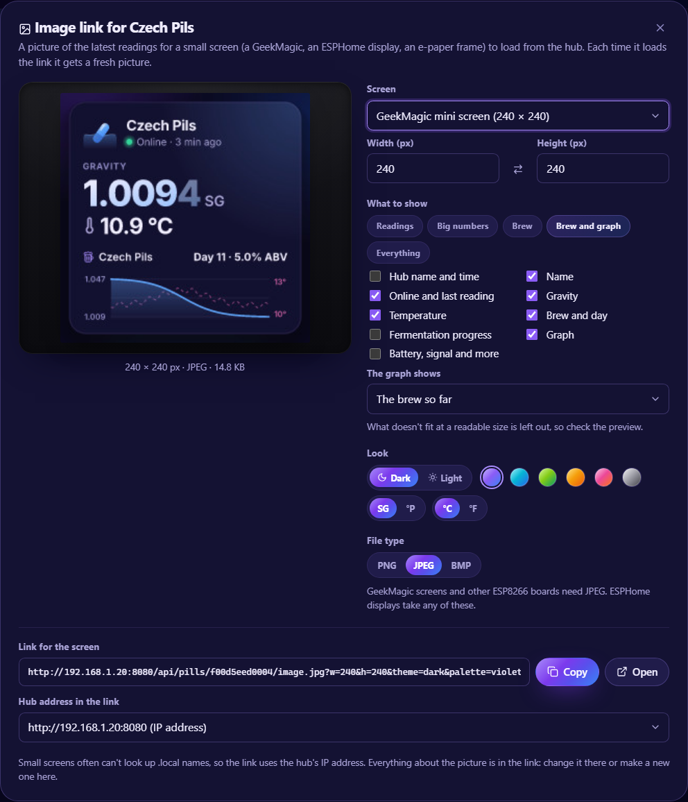

# Small screens

The hub can draw a picture of your pills for a screen that shows an image from a web address: an ESPHome display, a
GeekMagic mini screen, an e-paper photo frame, a digital signage player. The picture looks like the app, in its dark or
light theme and your choice of colours, and is laid out for the screen's size. It's drawn afresh every time the screen
loads the address, so the screen only has to load it again (every minute, say) to stay up to date.

## Examples

| GeekMagic mini screen, 240 × 240: one pill with **Brew and graph**, dark, Violet | 2.9″ e-paper, 296 × 128: every pill's name, gravity and temperature, light, Graphite |
| -------------------------------------------------------------------------------- | ------------------------------------------------------------------------------------ |
|               |                     |

A 7″ screen, 800 × 480: one pill with **Everything**, light, Ocean.



An HD TV, 1280 × 720: every pill with the hub's name and the time, the brew and the graph, dark, Hops.



## Make a link



1. Choose **Image link** on the dashboard (a picture of every pill) or on a pill's page (just that one).
2. Pick the screen: a preset (GeekMagic mini screen 240 × 240, small TFT and 3.5″ screens, 7″ screens, e-paper, HD and
   Full HD TVs) or any width and height from 64 to 2048 pixels. **⇄** swaps them for a screen on its side.
3. Pick what's on it: a preset (**Readings**, **Big numbers**, **Brew**, **Brew and graph**, **Everything**) or tick
   what you want: the hub's name and the time, the pill's name, whether it's online and when it was last heard, the
   gravity, the temperature, the brew and its day, its fermentation progress, a graph, and battery, signal and more.
   The graph covers the brew so far (the last day for a pill without one), or the last 1, 3 or 7 days.
4. Pick the look: dark or light, the colours, and the units. They start as this browser's.
5. Pick the file type the screen needs (see below), check the preview, and **Copy** the link.

The preview is the hub's own picture for that link, so it's what the screen will show. What doesn't fit at a readable
size is left out, the least important first (the small labels, the pill figure, the battery and signal boxes, the
progress bar, then the graph). Many pills on a small or wide screen are shown as compact rows instead of cards.

The link uses the hub's IP address, because small screens often can't find `.local` names. If your router may give the
hub a different address after a restart, reserve one for it in the router's settings, or pick another address for the
link under **Hub address in the link**.

The dialog remembers the screen, file type and what to show in each browser, so the next link starts from the same.

## File types

| Type     | For                                                                                                                                       |
| -------- | ----------------------------------------------------------------------------------------------------------------------------------------- |
| **JPEG** | GeekMagic and other ESP8266-based screens, which decode JPEG but not PNG, and most other screens. It's a baseline JPEG (not progressive). |
| **PNG**  | The sharpest: ESPHome on an ESP32, browsers, signage players.                                                                             |
| **BMP**  | Uncompressed 24-bit, for the simplest decoders. Big: 800 × 480 is about 1.1 MB.                                                           |

The **GeekMagic mini screen** preset picks JPEG for you.

## What's in the link

Everything about the picture is in the link itself, so you can change it there too. For example:

```
http://192.168.1.20:8080/api/image.jpg?w=240&h=240&theme=dark&palette=violet&show=name,status,gravity,temperature,brew,chart&range=brew&gravity=sg&temp=C&lang=en-GB&tz=Europe/London
```

| Path                                        | Picture of                                                               |
| ------------------------------------------- | ------------------------------------------------------------------------ |
| `/api/image.png` (`.jpg`, `.bmp`)           | Every pill and thermometer that isn't archived, in the dashboard's order |
| `/api/pills/:id/image.png` (`.jpg`, `.bmp`) | One pill or thermometer                                                  |

| Option    | Values                                                                                                                 | Left out                                     |
| --------- | ---------------------------------------------------------------------------------------------------------------------- | -------------------------------------------- |
| `w`, `h`  | Width and height in pixels, 64 to 2048                                                                                 | 800 × 480                                    |
| `theme`   | `dark`, `light`                                                                                                        | `dark`                                       |
| `palette` | `violet`, `ocean`, `hops`, `amber`, `rose`, `graphite`                                                                 | `violet`                                     |
| `show`    | Any of `header`, `name`, `status`, `gravity`, `temperature`, `brew`, `progress`, `chart`, `stats`, separated by commas | `name,status,gravity,temperature,brew,chart` |
| `range`   | What the chart covers: `brew` (the brew so far, or the last day without one), `1d`, `3d`, `7d`                         | `brew`                                       |
| `gravity` | `sg`, `plato`                                                                                                          | The hub's default units                      |
| `temp`    | `C`, `F`                                                                                                               | The hub's default units                      |
| `lang`    | The language and region for the words, numbers and time, e.g. `en-GB`, `de`, `pt-BR`                                   | `en`                                         |
| `tz`      | The time zone for the clock, e.g. `Europe/London`                                                                      | The hub's                                    |
| `brewing` | `1`: every pill's picture shows only those with a brew running                                                         | All of them                                  |

Anything left out or not understood takes its default, so a screen always gets a picture. A pill that doesn't exist (any
more) gets a picture saying so, with HTTP status 404.

Like the rest of the [read-only API](./api.md), the pictures are open to anyone who can reach the hub, so a screen
doesn't need to sign in.

## How often to refresh

Pills send a reading every few minutes, so loading the picture every minute or two is plenty. The hub draws the same
link at most once every 10 seconds (asking more often gets the same picture) and draws one picture at a time, so a few
screens can't swamp it. Big pictures take longer to draw, especially on an older Pi.

## ESPHome

ESPHome's [online image](https://esphome.io/components/image/online_image/) downloads a picture and draws it on any
display it supports. It needs a fair amount of memory, so an ESP32 (ideally with PSRAM) is the easy choice. For example,
for a 320 × 240 screen:

```yaml
http_request:

online_image:
  - id: rapthooker
    url: 'http://192.168.1.20:8080/api/image.png?w=320&h=240&theme=dark&palette=violet&show=name,status,gravity,temperature,brew,chart&range=brew&gravity=sg&temp=C&lang=en-GB'
    format: PNG
    type: RGB565
    update_interval: 60s
    on_download_finished:
      - component.update: screen

display:
  - platform: ili9xxx # your display
    id: screen
    update_interval: never
    # ...its pins and model...
    lambda: |-
      it.image(0, 0, id(rapthooker));
```

## GeekMagic mini screens

GeekMagic's small desk screens (240 × 240) run on an ESP8266, which decodes JPEG but not PNG: pick the **GeekMagic mini
screen** preset. What their own firmware can do with an image from a web address differs between models and versions;
community firmware (ESPHome among it) can load one on a timer.
